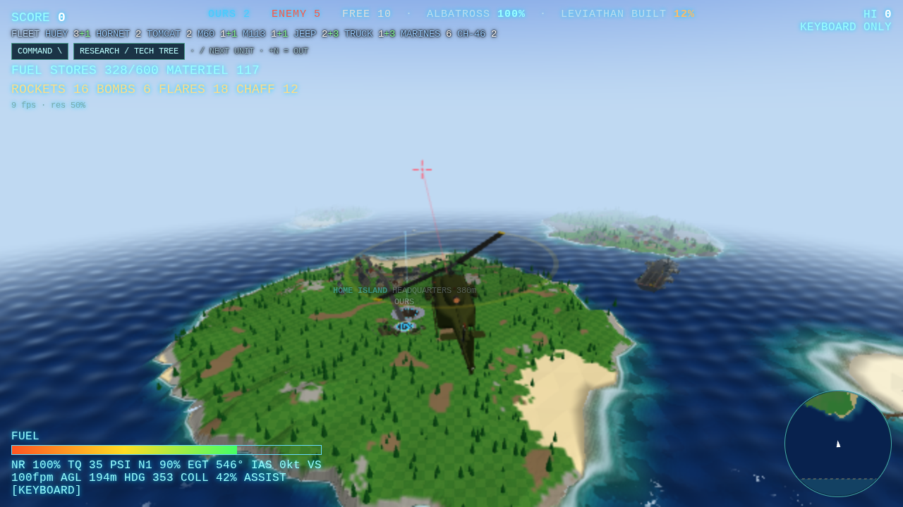

# NGC-1980

**1980.** Machines from the runaway star NGC-1980 have made a one-way jump back in time to Earth, bringing their own
war machines and modern weapons from our future. A joint Cold War task force is sent to stop them.

A browser game in Three.js (formerly *Thrust Zarch: The Island War*) that grew out of *Zarch*, *Thrust*, *Raid on
Bungeling Bay* and *Carrier Command*. Design bible: [docs/ngc1980/BIBLE.md](docs/ngc1980/BIBLE.md).
You fly a simulated helicopter from the deck of your carrier, the ALBATROSS, across a sea of 17 islands.
The enemy carrier KRAKEN is out there doing the same, and whoever controls the map wins.



## What's in it

- **Endless world.** The 17 islands are the CONTROL ZONE, where the war happens. Past it the world goes on for ever: open sea, then continents with coasts, forests and mountain ranges over a kilometre high, all perfectly flyable, just without objectives.
- **A lived-in world.** Villages and market towns with churches, shops and pubs, harbours with piers, trawlers and gulls, farms with walled fields, cows and sheep, lighthouses, radio masts and power lines, joined by a real road network (tarmac, lanes, farm tracks, bridges) that the ground is levelled for. People walk the streets and run indoors when the shooting starts; 1980 cars, vans, lorries and tractors drive the roads. The same world every run.
- **Two kinds of base.** Our 1980 sites (sandbagged HQ bunker, fuel farm with a nodding pumpjack, quonset-hut depot, a TPS-43 radar on its trailer) and the RUNAWAY's machine structures, which grow out of the ruins when they take an island, string glowing power pylons across it, and are left as dark shards when we take it back. Hits leave them smoking and scorched, then in ruins.
- **Archipelago and fog of war.** You only see what your helicopter, carrier, drones and islands can see. Radar islands see further.
- **Capture islands.** Silence the owner's AA guns, then land on the pad or send a drone. Fortress islands hide a cave: fly down the shaft, Thrust-style, and steal the pod. Every cave is procedurally generated (the same island always has the same cave), and the heavier the fortress, the deeper and more twisted its cave and the more turrets guard it.
- **Economy.** Islands produce fuel and materiel. Spend materiel on capture drones, AA guns, spare helicopters and escort fighters.
- **An enemy commander.** It sends transports to take islands, fortifies, raids your carrier, ships supplies by freighter, and builds a battleship in its factories that hunts the ALBATROSS. Bomb the factories to slow it down.
- **HORNET carrier jet.** Land on the ALBATROSS and press 5: an F/A-18-style fighter on the catapult. Full 6-DOF flight model with a Hornet-like flight computer, a 3D cockpit with a conformal HUD and working displays, catapult launches, arrested landings, gun, AIM-9s and CCIP bombs, ejection. Built for a T.Flight HOTAS 4 and rudder pedals with toe brakes (any stick, pad or keyboard works).
- **Para-drop repair team.** Downed on land? Press L and home base sends a steel dropship from over the horizon. You fly it in from the flight deck with a real fixed-wing flight model (or let the autopilot), line up the jump run against the wind, jump on the green light, then steer the canopies down; whoever lands on dry ground runs over with fuel and fixes the helicopter. Enemy flak can bring the dropship down.
- **SKY CARRIER.** Spend 300 materiel (6 on the map) and the ALBATROSS is refitted with four ducted lift fans and takes to the air. Land on her and press Tab to stand on the bridge: wheel, speed telegraph and lift lever, all slow and heavy. Send her anywhere from the map and she flies over the islands; flak can bring her down.
- **UH-1H Huey.** A Bell UH-1H with a validated flight model (teetering two-blade rotor with the Bell stabilizer bar, translational lift, ground effect, vortex ring state, retreating blade stall, a T53 engine with governor and freewheel so autorotations work), a full 3D cockpit with live instruments and the real caution panel, an authentic (optional) start sequence, the two-blade "wop wop", and a damage model where hits cause failures you can survive and repair. Built for a T.Flight HOTAS 4 + T-Rudder pedals: stick = cyclic, throttle lever = collective, pedals (or twist) = anti-torque; keyboard works too with the stability assist.
- **Ships that live and move.** The ALBATROSS is a 1980 Midway-class big deck in haze grey with a working deck: crew in coloured jerseys, tractors, Tilly, parked Hornets and Tomcats, an LSO team, the meatball, SPS-48 and SPS-49 turning, boiler smoke from the funnel. The enemy has a seized 2030s Ford-class supercarrier (the KRAKEN) refitted by the machines, the RW-9 LEVIATHAN railgun monitor and autonomous container ships. Every ship heaves, pitches and rolls with the sea state (`?sea=0..7`, default 4) and its speed, and the decks you land on move with them. Wakes, bow spray and smoke follow each ship's real track.
- **Air defences you can read.** Our islands are guarded by the Soviet contingent's ZSU-23-4s, and command 2 builds M163 Vulcans; the ALBATROSS carries two white-domed close-in guns and two box missile launchers. The RUNAWAY field seized 8x8 gun-missile trucks and, on their strongholds, the RW-5 LANCE laser. Every one of them has to see you (terrain blocks it) and lock on before it fires, and shows it: radars stop and point, barrels spin up, lamps blink faster, the LANCE glows and paints you with an aiming line, and a lock and missile warning sounds in the cockpit. Missiles steer but turn at a capped rate and go dumb if you drop behind a hill; smoke stops the laser. Stay low.
- **Effects that build up.** Smoke columns, fires, scorch marks, debris and oil slicks stay on the map.

Win by sinking the KRAKEN or taking IRONHOLD. You lose if the ALBATROSS sinks or you run out of helicopters.

## Run it

It's static files with no build step. Serve the `game/` folder and open it in a browser:

```
node tools/serve.mjs          # http://127.0.0.1:8765/
```

Any static server works (for example `npx serve game`). On Windows, `game/start.bat` does the same and opens the browser.

**Desktop launchers (Windows + WSL).** `bash launcher/install.sh` (run in WSL) puts two icons on the Windows desktop:
**Thrust Zarch** runs this checkout (`main`, port 8765) and **Thrust Zarch EXPERIMENTAL** runs the `experimental`
worktree next to it (port 8766, the icon with the orange EXP band). Each click starts that build's server inside WSL
(or reuses it) and opens the browser, so both builds can run side by side. Set up the experimental worktree once with
`git worktree add --track -b experimental ../thrust-zarch-experimental origin/experimental`, and `git pull` there to
update it. The launcher lives in `%LOCALAPPDATA%\ThrustZarch` (log: `launcher.log`).

**World preview and checks.** `game/dev/world.html` shows the lived-in world on its own (`?focus=town|village|hamlet|harbour|farm|bridge|zone`, `?structs=1` for every faction structure in every state, `?lod=far`). `node tools/worldbench.mjs` checks the road network and its determinism in node and draws a map to `tools/runs/`. `?noworld` turns the towns and traffic off (for A/B frame timing).

## Controls

| Key | Action |
|---|---|
| Space / Shift, Ctrl / Z | collective up / down |
| W A S D or arrows | cyclic |
| Q / E | pedals (anti-torque; the Huey needs some left pedal in the hover) |
| F / G / B | gun / rockets / bombs |
| R | winch (pick up the pod in a cave) |
| M | command map: click the sea to sail the carrier, click an island to select it |
| 1-5 | send drone, build AA gun, spare helicopter, escort fighter, SKY CARRIER refit |
| Tab | take / leave the SKY CARRIER helm (landed on her deck) |
| V / C | cockpit view / chase camera |
| H | stability assist on/off (on: the cyclic holds attitude, pedals hold heading; default for keyboard) |
| J | controls panel: bind and calibrate HOTAS / pedals (throttle lever = collective, pedals or twist = anti-torque) |
| I | engine: cut the fuel (autorotate) / with the engine stopped, the one-key start |
| PgUp / PgDn, Home | throttle twist grip (idle detent ... full open), starter (hold to 40% N1) |
| U / N / O / L | hydraulic control, landing light, fire extinguisher, call logistics (on the ground) |
| Esc / P | menu: resume, call logistics, respawn on the carrier if stuck, cockpit FOV slider, quit |

The Huey spawns hot at flight idle and rolls the throttle on by itself. With `?cold` it starts cold and dark: BAT and MAIN FUEL on, throttle to the idle detent (PgUp), hold the starter (Home) to 40% N1 (light-off at ~12%), let it reach idle (~70% N1), then throttle full open to 6600 rpm. The cockpit switches (battery, generator, inverter, main fuel, governor AUTO/EMER, hydraulic control, force trim, low rpm audio, starter, master caution) are clickable. To autorotate: collective down to keep 324 rpm, 70 kt, flare at ~100 ft, cushion with the collective.

### HORNET (jet)

| Key | Action |
|---|---|
| 5 | on the ALBATROSS deck: a Hornet on the catapult (throttle to MIL or afterburner and the cat fires) |
| W S A D / arrows, Q E | stick, rudder |
| Shift / Space, Ctrl / Z | throttle (above 80% is MIL, above 84% afterburner) |
| G / L / H / O | gear / flaps (AUTO, HALF, FULL) / hook / speed brake |
| . | wheel brakes (toe brakes on the pedals) |
| F / X / mouse, R, B | gun, A/A missiles (press again to fire), A/G bombs with CCIP (press again to drop) |
| , / I / U / N | master arm / engines / canopy / lights |
| hold Backspace | eject |
| V, mouse wheel, hat | cockpit or chase view, zoom, look around |
| J | controls panel: live view of every axis and button, bind and calibrate HOTAS / pedals |
| Y | stopped on the deck: back to the helicopter |

Cockpit switches are clickable (gear and hook handles, flaps, master arm, FCS CAS/DIRECT, engine cranks, fire lights, master caution, jettison, eject, DDI pages). To land: gear down, flaps FULL, hook down, fly the ICLS needles at 8° AoA (the green/amber/red indexer) into the wires.

The in-game help screen has the full list.

### On foot: medical and inventory (NGC-1980, work in progress)

The 1980 Marine gets Tarkov-style gear and a deep medical model (`game/js/units/infantry/`). Try it in the sandbox at
`dev/medinv.html`: pack a rifleman, grenadier, M60 gunner or Navy corpsman, take hits, watch the bleeding and shock
develop at x1 to x60, then treat him.

- **Gear (Tab):** drag and drop between pockets, the LC-2 belt and its ALICE pouches, the M69 vest and the ALICE pack. **R** rotates while dragging, **Shift-drag** splits a stack, **Ctrl-click** quick-moves, double-click inspects or opens a container, right-click opens the menu (unload, fill from rig, reload, quick slot, drop). Drop rounds on a magazine to load it (stripper clips are faster than thumbing). Bodies and crates are searched item by item. Arrows and Enter (or a gamepad d-pad and A) work as a cursor.
- **Health (H):** drag a dressing, tourniquet, splint, morphine syrette, IV (corpsman only) or canteen onto the body. Right-click a limb to tighten or remove a tourniquet. Blood volume follows the ATLS shock classes I-IV. A tourniquet is safe for 2 hours. The modern CAT tourniquet and QuikClot looted from the RUNAWAY's seized stocks are anachronisms that work far better than the 1980 strap-and-buckle.
### Infantry (NGC-1980 Marine rifleman, dev range)

`game/dev/infantry.html` is a firing range for the on-foot Marine of 1980 (M16A1 with M203, M60, M72 LAW, M1911A1):
pop-up E-type targets at 25-400 m, steel gongs, a spotting scope that shows where each round landed (drop against your
sight line, time of flight, speed), reload and malfunction drills, stamina on the hill, a pond to wade.
`?view=model` shows the weapons and the Marine's postures. Press I on the range for the controls.

| Key | Action |
|---|---|
| W A S D, Shift, Ctrl | move, sprint, walk toggle |
| C / Z / X, Q / E, hold Alt | crouch (kneel) / prone / stand, lean, free look |
| right mouse, left mouse, Shift on the sights | aim down the sights, fire, hold breath |
| 1-4, G, B | M16A1 (+M203) / M60 / LAW / M1911, M203 on/off, fire mode |
| R, R R | tactical reload (keeps the magazine), speed reload (drops it); LAW: extend, then arm |
| T, Shift+T, Y, U | immediate action (SPORTS), remedial action, charging handle, forward assist |
| K / J / L / H / N | check magazine / check chamber / inspect / M60 barrel change / bipod |
| PgUp PgDn or [ ], arrows | sight setting (aperture, leaf, M203 quadrant), zeroing clicks |
| F, Backspace, M, P, V | pick up a dropped magazine, reset targets, spotting scope, bullet trails, third person |

## Tests

`tools/` has a headless test harness: Puppeteer drives the game in software WebGL and takes screenshots. See [tools/README.md](tools/README.md).

```
cd tools && npm install && node snap.mjs scenes/war.json
node tools/jetbench.mjs             # the jet's flight model against published F/A-18C figures, in plain node
node tools/hueybench.mjs            # the Huey's flight model against published UH-1H data (Heffley, Talbot, DCS / TM charts)
node tools/medinvbench.mjs          # medical (ATLS shock timing, tourniquets, drugs, IV), kit weights, inventory grids
```

Medical and inventory scenes: `medinv.mjs` (hits, bleeding, a mouse-dragged tourniquet, gear, looting, inspect, death) and `medinv_ui.mjs` (rotate, split, menu, container window, quick move, cursor, corpsman IV, class IV vision).
node tools/navalbench.mjs           # ship motion in a seaway: sea states, carrier pitch / heave / roll, turn heel, deck maths
```

Naval: `game/dev/ships.html` orbits each ship on a sea with sea-state, speed and turn sliders (`?ship=albatross|kraken|leviathan|container`). Scenes: `naval.mjs` (every ship in the game, the deck moving with the sea, crew clearing out from under a helicopter), `shipsdev.mjs` (the preview page from many angles, draw calls).

Jet scenes: `jet.mjs` (launch, climb, turn), `jettrap.mjs` (arrested landing), `jetweapons.mjs` (AIM-9, gun, CCIP), `jetsystems.mjs` (damage, fire, DIRECT, G-LOC, ejection), `jetterrain.mjs` (TERRAIN and PULL UP at a mountain).
`node tools/cavebench.mjs` checks the cave generator without a browser: it prints every island's cave as an ASCII map and
sweeps hundreds of seeds per tier, checking that each cave is connected, wide enough to fly and has its pad, tanks and
pod on solid floors. `scenes/caves.mjs` flies into every cave and screenshots it.
Air defence: `game/dev/defence.html` is a sandbox to view each AA unit and watch it engage target drones (`?unit=talon&player=1`, smoke and ridge included); `defence.mjs` (model close-ups, engagements, line of sight, the LANCE and smoke), `defencewar.mjs` (the units in the game, a lock and missile on the player, hiding behind a hill), `defbalance.mjs` (damage rates against the old AA gun).
`node tools/infantrybench.mjs` checks the infantry cores (flight of the rounds against the field-manual maximum ranges and
zeroes, rates of fire, barrel heat, stoppages, recoil, march / run / sprint speeds and stamina against the Pandolf and
ACSM equations); `scenes/infantry.mjs`, `infantrydrills.mjs` and `infantrymodels.mjs` drive the range page.
Huey scenes: `hueystart.json` (cold start), `hueyhover.json` (hover trim, forward flight), `hueyauto.json` (practice autorotation with power recovery), `hueycockpit.mjs`, `hueymodel.mjs` (screenshots).

**RUNAWAY ground forces (NGC-1980, not in the game yet).** The enemy's land army as standalone sims and models in
`game/js/units/runaway/`: the RW-1 STRIDER (a balancing biped that stumbles when hit, falls and gets back up), the
RW-7 hover tank (fan-fed air cushion, drifts), seized M1A2 SEPv3 and T-90M tanks, and a squad AI (cover, bounds,
flanking, suppression, retreat, combined arms). Try them in the sandbox `game/dev/runaway.html` (keys 1-6 pick a
fight, F follows a unit, O toggles the AI overlay, click for sound) and on the turntable `game/dev/rwmodels.html?unit=strider|hover|m1|t90|all`.
`node tools/runawaybench.mjs` checks locomotion on 20° slopes, push recovery, hover physics, the tanks' dimensions and
the squad behaviours in plain node; scenes `runaway.mjs`, `runawaycloseup.mjs`, `runawaylive.mjs`, `rwmodels.mjs`,
`striderfall.mjs` photograph them.

## Credits

Built by Jason with Claude (Anthropic) as an AI pair-programmer. Uses [three.js](https://threejs.org) (MIT), vendored in `game/vendor/`.
