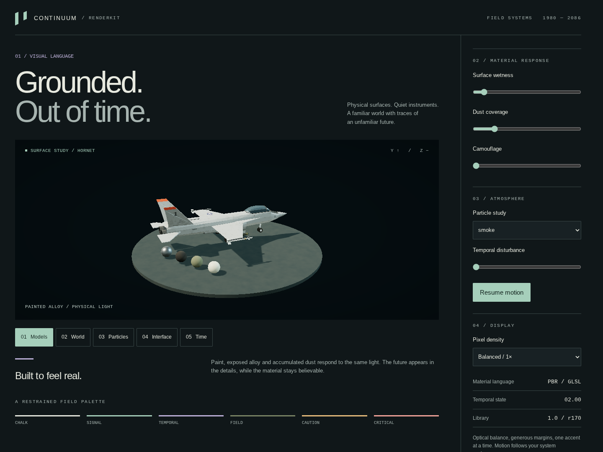
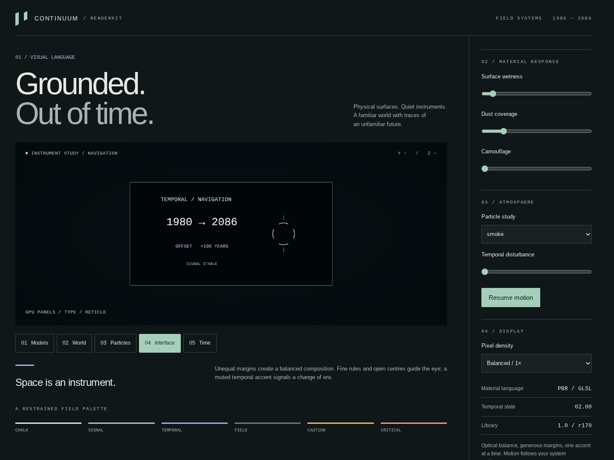

# RenderKit validation — 2026-10-26

**PASS:** 74 browser GPU/API checks, 20/20 harness assertions, no page or console errors.
Repository syntax: **488/488 modules**. The final gallery-only geometry adjustment also passed
its syntax check and the complete browser fixture.

- Branch: `ngc/shader-library`, based on `4017e45a47476642c8ee0c5b1f81ebac1c092a1b`.
- The run records the base commit plus uncommitted library content; its exact game content hash is
  `799d179e748f133d123d7be2243e06df9cdcbde7e61a50760da4370bd5fdbe27`.
- Fixture hash: `9982d7204024d10a60cb6b9e00f0182abcbae1736c4e41c9e4e8329e0ae35aca`.
- Browser: HeadlessChrome 156.0.8078.47, ANGLE Vulkan **SwiftShader software renderer**.
- Viewport: 1440×1080; the preview drawing buffer is 1012×430. Mobile check: 390×844.
- Raw run: `tools/runs/renderkit-release/` (ignored local output).
- Portable copies: [result.json](renderkit-evidence/result.json) and
  [benchmark.json](renderkit-evidence/benchmark.json), with all six captured PNGs below.

The browser checks render and read back pixels for every surface preset, masked PBR, glass,
foliage, decals, terrain, water, all seven particle kinds, sky, temporal material, HUD and SDF/MSDF.
They exercise live wetness, independent uniforms, cache separation, instancing, skinning, morphs,
existing fog-of-war hook composition and built-in distance fog. They also check perspective and
orthographic depth fading, expired bursts, text layout/empty updates, borrowed atlas ownership,
post resize/disposal and renderer-state restoration. All 39 retained linked programs were runnable;
WebGL reported no error. A neutral post chain matched direct output at **RGB 151/151/151**,
checking that tone mapping/display conversion occurs once.

The UI fixture uses real controls for gallery navigation, material sliders, particle selection,
temporal distortion, pause/resume and pixel density. Mobile content fits the viewport. Reduced
motion is checked after removing the `?still` capture override. ReadPixels produced expected
software-driver stall warnings during correctness checks; those checks finish before timing.

The first full run caught stale canvas-label pixels after shrinking text. The helper now replaces
its GPU texture allocation when rebuilding the canvas; the regression check confirms empty text
produces zero remaining glyph pixels. Visual inspection also prompted a closer instrument view
and removal of terrain-grid corners from the circular preview stand.

## Captured views

| Models | Interface |
| --- | --- |
|  |  |

Other inspected captures: [terrain/water](renderkit-evidence/02-terrain.png),
[smoke](renderkit-evidence/03-particles.png), [temporal effect](renderkit-evidence/05-temporal.png),
[mobile layout](renderkit-evidence/06-mobile.png).

The images show a lit aircraft/material study, blended terrain with water, soft smoke, legible GPU
text/reticle, an edge-lit temporal form and responsive DOM layout. Screenshots do not prove all
motion frames or all possible assets. No video was captured.

## Measurement limits

Model preview: 30 rendered intervals after 10 warmup frames, **16.63 ms mean / 17.50 ms p95**.
This short software-rendered preview sample is not a gameplay performance claim or a before/after
comparison. Sampling ran without screenshots/video or concurrent syntax checks. CPU phase timings
are unavailable in this preview. Draw counts describe the last fullscreen post pass, not the total
world draws. No hardware GPU, XR headset, production mission, large-world precision, sustained
particle load or cross-browser qualification was performed.

The post pipeline is desktop-only; PBR/GLSL usage, depth conventions and other integration limits
are explicit in [the guide](renderkit.md). Both the source and the checks are included on the branch
for future integration work.
